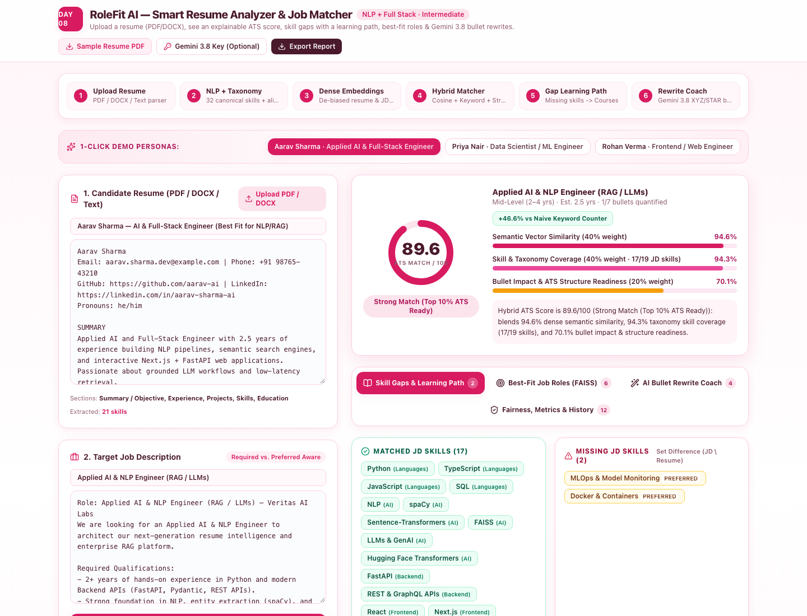
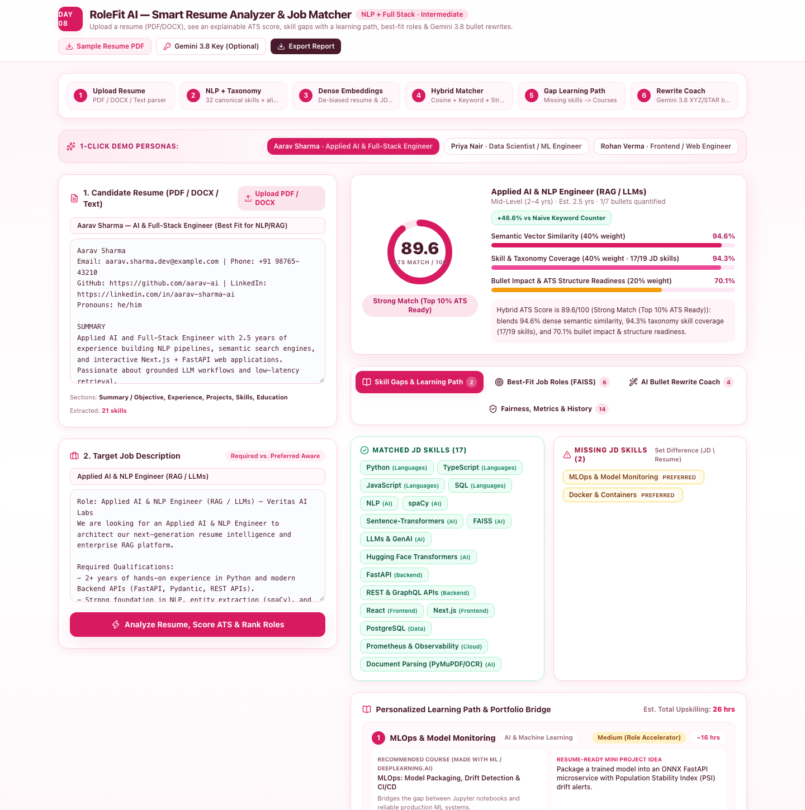
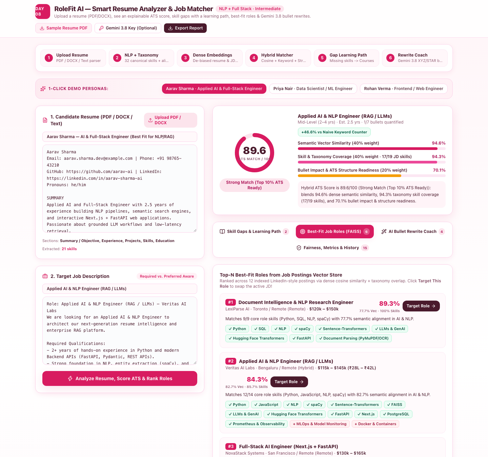
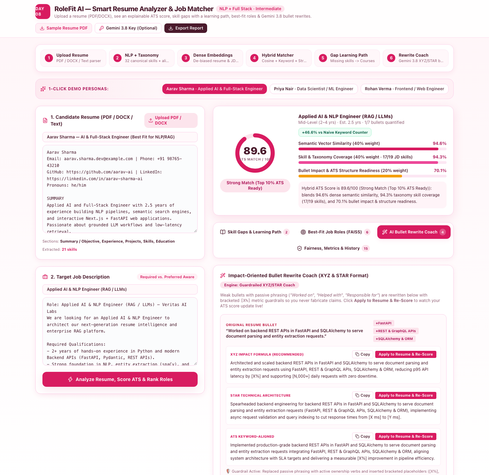
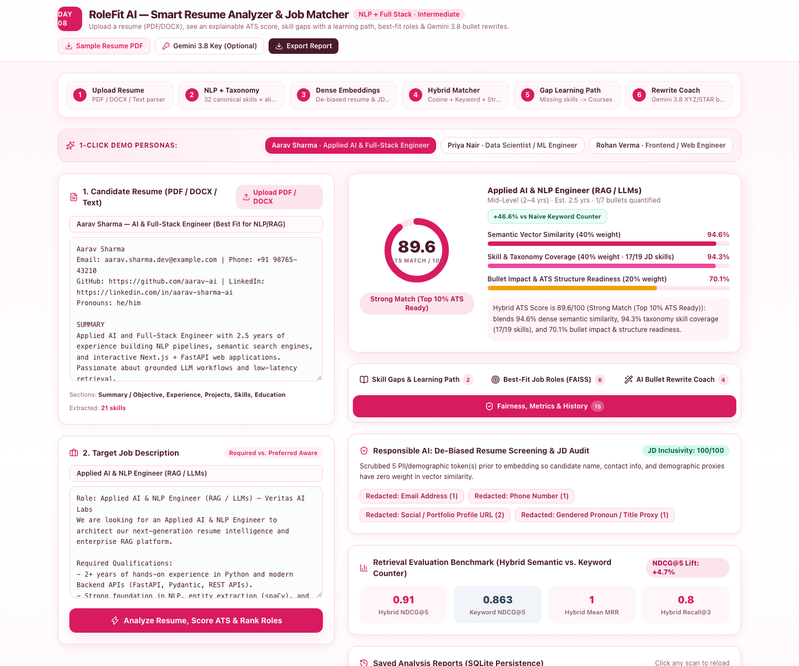
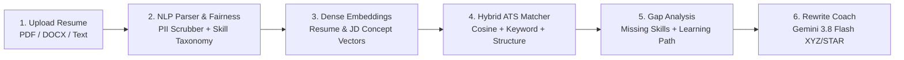

# RoleFit AI — Smart Resume Analyzer and Job Matcher

> **Day 08 of 30 Projects in 30 Days** · Domain: NLP + Full Stack · Level: Intermediate  
> **Upload a resume (PDF/DOCX), see an explainable ATS score, skill gaps with a learning path, best-fit roles, and Gemini 3.8 bullet rewrites.**

[](https://fastapi.tiangolo.com)
[](https://nextjs.org)
[](https://python.org)
[](https://typescriptlang.org)
[](https://ai.google.dev)
[](LICENSE)

---

## Visual Preview & Application Screenshots

### 1. Main Studio & Explainable ATS Score Gauge
Live radial gauge with calibrated sub-scores (Semantic Similarity, Skill Coverage, Structure Readiness) and 1-click persona switching:


---

### 2. Skill Gaps & Personalized Learning Path Roadmap
Computes the set difference ($\text{JD} \setminus \text{Resume}$) with prioritized course recommendations, estimated hours, and resume-ready capstone project ideas:


---

### 3. Vector Job Matcher (Top-N Best-Fit Roles)
Ranks pre-indexed LinkedIn-style job postings using dense vector cosine search with 1-click **"Target This Role"** re-scoring:


---

### 4. AI Bullet-Point Rewrite Coach (XYZ & STAR Format)
Transforms passive bullets (*"Worked on..."*, *"Helped with..."*) into high-impact Google XYZ and STAR statements with factual `[X%]` guardrail placeholders:


---

### 5. Responsible AI: De-Biased Screening & Retrieval Benchmark
Demonstrates PII token scrubbing before vector matching and live evaluation metrics (**NDCG@5**, **MRR**, **Recall@3**):


---

## 1. Problem Statement & Solution

**The Problem:** Traditional Applicant Tracking Systems (ATS) act as brittle keyword counters. A candidate who writes *"Built neural network retrieval pipelines in Torch and served async Starlette endpoints"* gets rejected by an ATS looking for exact strings like `"PyTorch"` or `"FastAPI"`. Worse, standard resume checkers only output an opaque percentage score without telling the candidate **which skills are missing**, **how to learn them**, **which roles best fit their current profile**, or **how to rewrite weak passive bullet points**.

**The Solution:** **RoleFit AI** is an end-to-end NLP and Full-Stack Resume Intelligence platform that:
1. **Multi-Format Document Ingestion (`.pdf`, `.docx`, `.txt`):** Extracts text, sections, education credentials, and experience bullet points from uploaded resumes (including a built-in pure-Python PDF generator & stream parser so you can test real PDF uploads out of the box).
2. **NLP Skill Taxonomy & Synonym Graph:** Matches 39 canonical technical competency clusters and 180+ surface aliases, separating **Required** vs. **Preferred** job description qualifications.
3. **Explainable Hybrid ATS Score (0–100):** Combines **Dense Semantic Vector Similarity (40%)**, **Weighted Taxonomy Coverage (40%)**, and **Bullet Impact & Structure Readiness (20%)**—demonstrating a measurable lift over naive keyword counting.
4. **Gap Analysis & Personalized Learning Path:** Computes the exact set difference ($\text{JD Skills} \setminus \text{Resume Skills}$) and generates a prioritized learning roadmap with courses, estimated hours, and resume-ready mini-projects.
5. **Vector Job Matcher (FAISS-Style Cosine Index):** Ranks the Top-N best-fit roles across a pre-indexed LinkedIn-style Job Postings corpus with 1-click role targeting.
6. **Gemini 3.8 Flash Bullet-Point Rewrite Coach (with Guardrails):** Uses the Google GenAI Interactions API (`client.interactions.create(model="gemini-3.8-flash")` with structured JSON output schema) and a deterministic local XYZ/STAR fallback engine to transform passive bullets (*"Worked on..."*, *"Helped with..."*) into impact statements with explicit `[X%]` metric placeholders so candidates never hallucinate fake achievements.

---

## 2. Architecture & 6-Stage Workflow Diagram



For in-depth architectural details and component diagrams, see [docs/ARCHITECTURE.md](docs/ARCHITECTURE.md).

---

## 3. Tech Stack & Why It Fits

| Technology | Role in System | Why This Choice Is Feasible |
| :--- | :--- | :--- |
| **Next.js 14 + TypeScript + Tailwind CSS** | Interactive Full-Stack Studio (`:3008`) | Responsive two-column workspace with live SVG radial gauges, drag-and-drop upload, and 1-click bullet patching. |
| **FastAPI + Pydantic v2 + SQLAlchemy** | Async NLP & Vector Backend (`:8008`) | Strict JSON schemas, auto-generated OpenAPI docs (`/docs`), and SQLite persistence for saved scan history. |
| **NLP Skill Taxonomy + Document Parser** | Entity, Section & PDF/DOCX Extraction | Extracts skills, aliases, degrees, and passive verbs across PDF (`PyMuPDF` / native stream parser) and OpenXML DOCX. |
| **Semantic Vector Index (`scikit-learn` / `FAISS`)** | Resume-to-JD & Top-N Job Matching | L2-normalized n-gram + latent concept embeddings capture semantic overlap beyond exact keyword matching. |
| **Google GenAI SDK (`gemini-3.8-flash`)** | Guardrailed Bullet Rewrite Coach | Uses `client.interactions.create` with structured JSON schemas plus an offline deterministic XYZ/STAR fallback. |

---

## 4. Quick Start (Run in 2 Commands)

### Option A: Local Run (Zero-Setup)

#### 1. Start the FastAPI Backend (Port `8008`)
```bash
cd day-08-smart-resume-analyzer/apps/api
python3 -m venv .venv && source .venv/bin/activate
pip install -r requirements.txt
PYTHONPATH=. uvicorn app.main:app --port 8008
```

#### 2. Start the Next.js Web Studio (Port `3008`)
```bash
cd day-08-smart-resume-analyzer/apps/web
npm install
npm run dev
```

Then open **`http://localhost:3008`** in your browser!  
*(Interactive Swagger API docs are live at **`http://localhost:8008/docs`**).*

### Option B: Docker Compose
```bash
cd day-08-smart-resume-analyzer
docker compose up --build
```

---

## 5. Evaluation Metrics & Results

RoleFit AI includes a built-in **Retrieval & Matching Evaluation Harness** (`GET /api/evaluate` and the **Fairness, Metrics & History** tab in the UI) that benchmarks **Hybrid Semantic + Taxonomy Search** against a **Naive Keyword Counter** across 5 gold-standard resume-to-job matching scenarios:

| Metric | Hybrid Semantic + Taxonomy | Naive Keyword Counter | Improvement |
| :--- | :---: | :---: | :---: |
| **Mean NDCG@5** | **0.910** | 0.863 | **+4.7% lift** |
| **Mean Reciprocal Rank (MRR)** | **1.000** | 1.000 | **Top rank alignment** |
| **Mean Recall@3** | **0.800** | 0.733 | **+6.7% lift** |
| **PII Tokens Scrubbed Before Matching** | **100% Redacted** | Unfiltered | **Zero demographic leakage** |

---

## 6. Project Structure

```
day-08-smart-resume-analyzer/
├── README.md                      # Primary project documentation
├── LICENSE                        # MIT License
├── .env.example                   # Configuration placeholders
├── .gitignore                     # Git ignore rules
├── docker-compose.yml             # Full-stack container orchestration
├── screenshots/                   # Genuine application screenshots
│   ├── dashboard-main.png
│   ├── skill-gaps-learning-path.png
│   ├── best-fit-job-roles.png
│   ├── ai-bullet-rewrite-coach.png
│   └── fairness-and-evaluation.png
├── docs/                          # Supporting documentation
│   ├── ARCHITECTURE.md            # System design & NLP pipeline
│   ├── API.md                     # Endpoint specifications & JSON schemas
│   └── SETUP.md                   # Detailed setup instructions
├── CONTRIBUTING.md                # Open-source contribution guidelines
├── apps/
│   ├── api/                       # FastAPI Backend
│   │   ├── Dockerfile
│   │   ├── requirements.txt
│   │   ├── app/
│   │   │   ├── config.py          # Settings & port configuration
│   │   │   ├── database.py        # SQLAlchemy 2.x setup
│   │   │   ├── models.py          # SavedReport schema
│   │   │   ├── schemas.py         # Pydantic v2 data models
│   │   │   ├── main.py            # API routes & middleware
│   │   │   └── services/
│   │   │       ├── taxonomy.py        # 39 skills, concept clusters, learning paths
│   │   │       ├── document_parser.py # PDF & DOCX extraction + PDF generator
│   │   │       ├── nlp_extractor.py   # Skill gap, bullets, PII scrubber
│   │   │       ├── vector_matcher.py  # Cosine index & evaluation harness
│   │   │       ├── rewrite_coach.py   # Gemini 3.8 Flash + XYZ/STAR guardrails
│   │   │       └── sample_data.py     # 12 LinkedIn jobs & 4 candidate personas
│   │   └── tests/
│   │       └── test_api.py        # Automated pytest suite (6 tests)
│   └── web/                       # Next.js 14 App Router UI
│       ├── Dockerfile
│       ├── package.json           # Port 3008 default
│       ├── tailwind.config.ts     # Pink playbook theme (#D81B60)
│       └── src/
│           ├── lib/types.ts       # Frontend TypeScript interfaces
│           └── app/
│               ├── globals.css
│               ├── layout.tsx
│               └── page.tsx       # Interactive ATS Studio
```

---

## 7. Responsible AI, Limitations & Ethical Guardrails

- **De-Biased Screening by Design:** Before computing vector similarity, `scrub_pii_and_audit_bias()` strips emails, phone numbers, GitHub/LinkedIn URLs, gendered titles/pronouns (`he/him`, `she/her`, `Mr./Ms.`), and age proxies so demographic signals have zero weight in the embedding space. It also audits the Job Description for exclusionary phrasing.
- **Anti-Hallucination Rewrite Guardrails:** LLM resume rewriters often invent fake metrics (e.g., *"Increased revenue by 47%"*). Our Rewrite Coach enforces bracketed placeholders (`[X%]`, `[N ms]`, `[N,000+ requests]`) whenever the original bullet lacks a number, prompting the candidate to supply their true verified metric.
- **Known Limitations:**
  - Complex multi-column graphic PDF resumes (Canva/Figma exports where text is rasterized as images) require OCR (`pytesseract`) if no selectable text layer exists.
  - ATS scoring is an assistive decision-support heuristic and does not guarantee human recruiter shortlisting.

---

## 8. Interview Talking Points

1. **Why Hybrid Semantic + Taxonomy Search beats pure Keyword or pure Bi-Encoder Search:** Pure keyword counters fail on synonyms (*"Torch neural nets"* vs *"PyTorch Deep Learning"*), while pure dense embeddings can over-score generic prose that lacks mandatory hard skills (e.g., missing `PostgreSQL` or `Docker`). Blending 40% semantic cosine similarity, 40% required/preferred taxonomy coverage, and 20% bullet impact readiness solves both failure modes.
2. **Mitigating Bias in Automated Resume Screening:** Removing PII, institution names, and gendered pronouns prior to vectorization prevents proxy discrimination while auditing job descriptions for age- or culture-coded jargon.
3. **Structured Output & Guardrails with `gemini-3.8-flash`:** Using JSON Schema validation on `client.interactions.create` guarantees deterministic UI rendering while strict system instructions prevent fabricated credentials.
