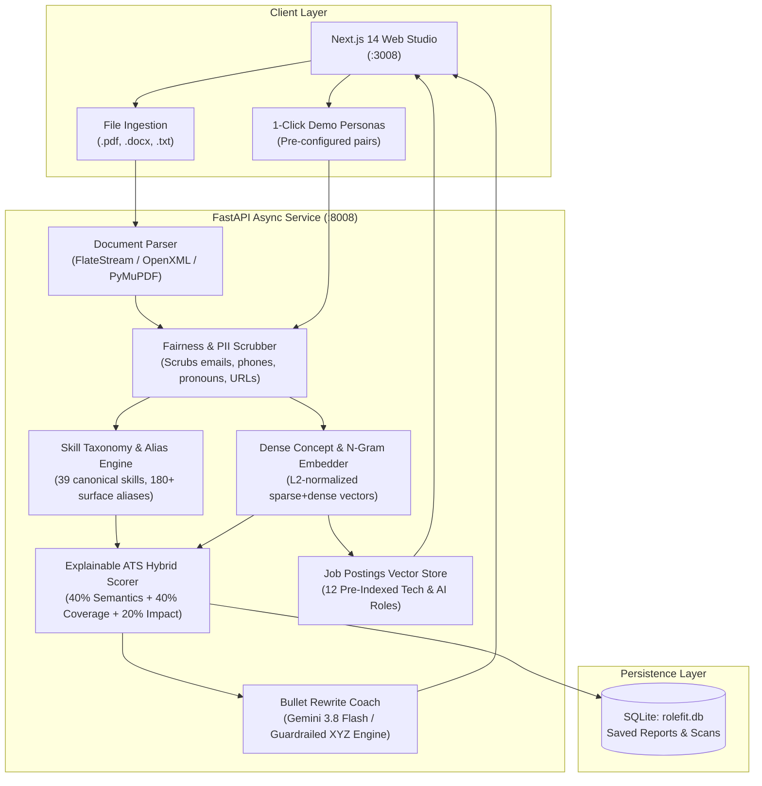

# System Architecture & NLP Workflow

`RoleFit AI` is designed around a 6-stage explainable Natural Language Processing (NLP) and Vector Search pipeline.

---

## High-Level Architecture Diagram

---

## 1. Document Ingestion & Parsing

The parser supports three common formats:
- **PDF (`.pdf`):** Extracts text operators (`Tj`, `TJ`, `'`, `"`) from decompressed `/FlateDecode` content streams using pure Python stdlib (`zlib`), with automatic fallback to `fitz` (PyMuPDF) or `pypdf` when installed. It also provides a built-in valid PDF generator (`/api/samples/{id}/pdf`) for downloading test resumes.
- **DOCX (`.docx`):** Uses pure-Python `zipfile` + `xml.etree.ElementTree` parsing of `word/document.xml`, extracting `<w:t>` and `<w:p>` nodes.
- **Plain Text (`.txt`, `.md`):** UTF-8 / latin-1 fallback with normalized line endings.

---

## 2. Responsible AI: PII & Bias Scrubbing

Before any vector embeddings or semantic similarities are calculated:
- **Email, Phone & Social Links:** Redacted using regex boundary matchers.
- **Gendered Titles & Pronouns:** Redacted (`Mr.`, `Ms.`, `he/him`, `she/her`).
- **Age / Grad Year Proxies:** Scrubbed from the text passed to the embedding model.
- **Job Description Inclusivity Audit:** Flags exclusionary jargon (e.g., *"rockstar"*, *"digital native"*, *"work hard play hard"*).

---

## 3. NLP Skill Taxonomy & Concept Expansion

Rather than matching rigid literal keywords, the system maps surface aliases to canonical entities:
- *"Torch"* $\rightarrow$ **PyTorch** (`AI & Machine Learning`)
- *"Nextjs App Router"* $\rightarrow$ **Next.js** (`Frontend & UI`)
- *"FastAPI / Pydantic"* $\rightarrow$ **FastAPI** (`Backend & APIs`)

Latent semantic clusters enrich the text prior to vectorization:
- **`concept_deep_learning`**: Links *PyTorch*, *TensorFlow*, *Neural Network*, *Transformers*, *Backpropagation*, *Fine-Tuning*.
- **`concept_nlp_search`**: Links *NLP*, *spaCy*, *Sentence-Transformers*, *Vector DB*, *FAISS*, *RAG*.

---

## 4. Hybrid ATS Score Formulation

The overall score $S_{\text{ATS}} \in [0, 100]$ is computed as:

$$S_{\text{ATS}} = 0.40 \cdot S_{\text{semantic}} + 0.40 \cdot S_{\text{taxonomy}} + 0.20 \cdot S_{\text{structure}}$$

Where:
- $S_{\text{semantic}}$ is the calibrated cosine similarity between the de-biased resume vector $\mathbf{v}_{\text{resume}}$ and job vector $\mathbf{v}_{\text{jd}}$:
  $$S_{\text{semantic}} = \min\left(99, 108 \cdot \sqrt{\max(0, \mathbf{v}_{\text{resume}} \cdot \mathbf{v}_{\text{jd}})}\right)$$
- $S_{\text{taxonomy}}$ is the weighted skill coverage score giving $1.0\times$ weight to Required skills and $0.5\times$ to Preferred skills.
- $S_{\text{structure}}$ combines standard ATS section completeness ($45\%$) and bullet action-verb/metric strength ($55\%$).

---

## 5. Gemini 3.8 Flash Rewrite Coach with Factual Guardrails

Weak resume bullets are converted into Google XYZ (`Accomplished [X] as measured by [Y], by doing [Z]`) and STAR technical architecture formats.

### Guardrail System
To avoid fabricating achievements:
- Original metrics are preserved.
- When numbers are missing, explicit bracketed placeholders (`[X%]`, `[N ms]`, `[N,000+ requests]`) are inserted so the candidate supplies their real verified metric.
- Works live via `client.interactions.create(model="gemini-3.8-flash")` with structured JSON schema when `GEMINI_API_KEY` is present, and falls back to a deterministic local engine when offline.
